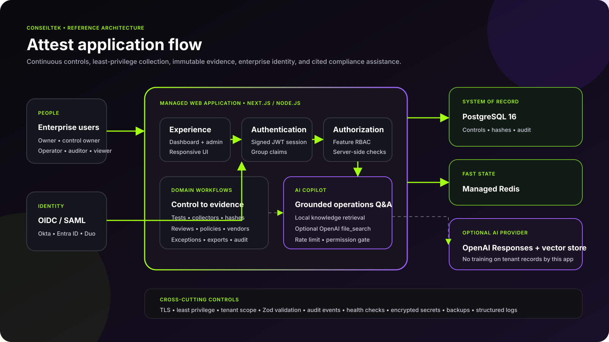
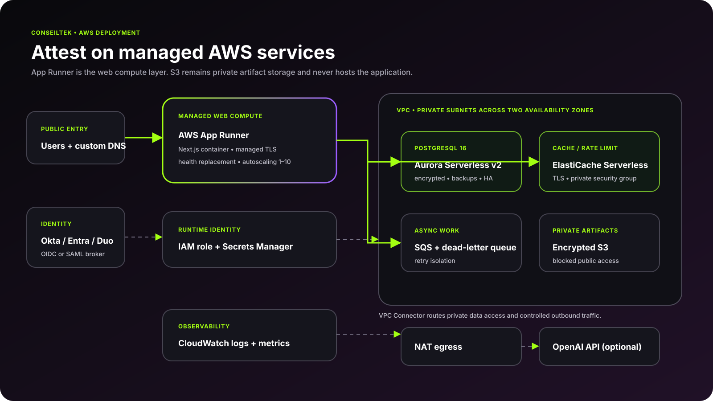
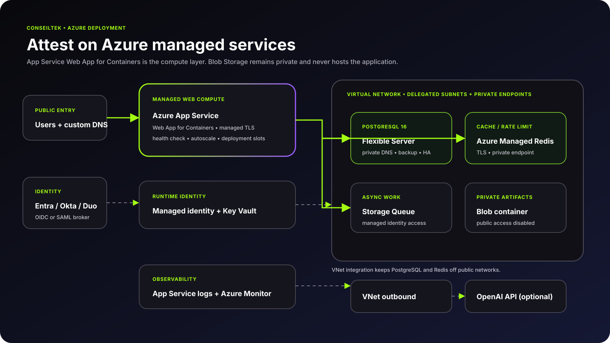

<div align="center">
  
  <h1>Attest</h1>
  <p><strong>Continuous compliance evidence, collected in your account.</strong></p>
  <p>SOC 2 and ISO mappings · immutable evidence · access reviews · enterprise SSO · configurable RBAC · grounded AI</p>
</div>

[](https://github.com/ConseilTek-Tektons/attest/actions/workflows/ci.yml) [](https://github.com/ConseilTek-Tektons/attest/actions/workflows/codeql.yml) [](LICENSE)

Attest turns controls into repeatable tests and verifiable evidence without moving the compliance record outside your cloud boundary. One control can map to multiple frameworks, collectors run with read-only identities, and every evidence object is hashed and append-only. This repository ships the application and complete AWS/Azure deployment package.



## Working capabilities

- Frameworks, control mappings, automated tests and runs, SHA-256 evidence, access reviews, policies, acknowledgements, vendors, exceptions, and audit records
- PostgreSQL trigger-enforced append-only evidence plus a permission-checked collection API
- Configurable roles for owners, administrators, compliance managers, control owners, auditors, evidence operators, and viewers
- OIDC for Okta or Microsoft Entra ID; SAML providers including Duo connect through Keycloak or another OIDC broker
- Compliance copilot grounded in opted-in metadata, with citations, no raw-evidence export, and no audit-opinion claim
- ConseilTek-branded posture dashboard, working collector interaction, access-policy editor, health endpoint, and responsive layout
- Docker Compose plus AWS Terraform and Azure Bicep deployment paths

## Run locally

```bash
cp .env.example .env
docker compose up --build
```

Open [http://localhost:3000](http://localhost:3000); Keycloak runs on port 8080. For manual development use `pnpm install`, `pnpm db:migrate`, `pnpm db:seed`, and `pnpm dev`.

## Managed cloud deployment

Attest requires authenticated server logic, collector orchestration, PostgreSQL transactions, and AI controls. Static website hosting is not an appropriate runtime.

| Cloud | Managed web runtime | PostgreSQL | Cache | Deployment |
|---|---|---|---|---|
| AWS | AWS App Runner | Aurora PostgreSQL Serverless v2 | ElastiCache Serverless | [Terraform](infra/aws/README.md) |
| Azure | Azure App Service Web App for Containers | PostgreSQL Flexible Server | Azure Managed Redis | [Bicep](infra/azure/README.md) |

Managed services reduce maintenance for compute replacement, TLS, scaling, database backup and patching, and cache operations. Private object storage holds evidence; production deployments must apply the documented retention and immutability policy.





## Operate and extend

- [Architecture](docs/ARCHITECTURE.md) · [Authentication](docs/AUTHENTICATION.md) · [RBAC](docs/RBAC.md)
- [AI and RAG](docs/AI.md) · [Security](docs/SECURITY.md) · [Operations](docs/OPERATIONS.md)
- Quality gate: `pnpm check`, Terraform validation, Bicep compilation, and an OCI container build

## Ownership

Attest is designed, built, and maintained by [ConseilTek](https://conseiltek.com) and licensed under Apache 2.0. ConseilTek trademarks and supplied brand artwork are not granted by the source-code license. Contact [support@conseiltek.com](mailto:support@conseiltek.com).
