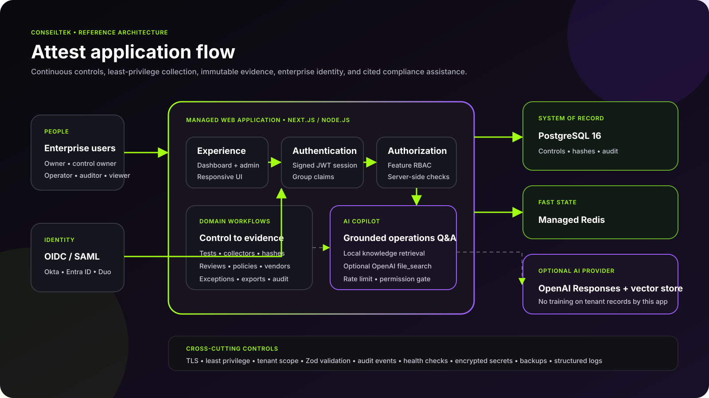

# Attest architecture

Attest is a control and evidence platform with a stateless web container, PostgreSQL control plane, asynchronous collectors, and immutable object storage. The reference cloud templates use managed services so teams operate the compliance process rather than servers.

## Collection and review flow

1. App Runner or App Service authenticates interactive users through enterprise OIDC; SAML can be brokered through Keycloak.
2. A scheduler or authorized operator queues a versioned compliance test. Its collector uses a dedicated read-only cloud or SaaS identity.
3. The collector observes source state, serializes evidence, calculates SHA-256, writes the object to retention-protected storage, and appends evidence metadata in PostgreSQL.
4. PostgreSQL rejects evidence update/delete through a trigger. A correction is new evidence linked to a new run.
5. One implemented control maps to exact requirements across SOC 2, ISO 27001, or additional configured frameworks.
6. Review and export routes recheck feature RBAC and write audit events. The compliance copilot receives only opted-in metadata and cannot issue an audit opinion.

## Bounded modules

| Module | Owns |
|---|---|
| Control plane | frameworks, controls, requirement mappings, owners, status |
| Test engine | collector configuration, run lifecycle, results, least-privilege identity |
| Evidence | SHA-256 manifest, retention, immutable objects, provenance |
| Governance | access reviews, policies, acknowledgements, vendors, exceptions, exports |
| Trust | enterprise identity, configurable RBAC, audit, grounded assistant |

## Evidence invariants

- Evidence rows are append-only and object keys are unique within the organization.
- Hashes are lowercase SHA-256 and verified before inclusion in an export.
- Secrets and raw credentials never enter evidence metadata, logs, or AI prompts.
- AI output is a cited draft, not an auditor conclusion or approval action.

AWS uses App Runner, Aurora PostgreSQL Serverless v2, and private S3. Azure uses App Service Web App for Containers, PostgreSQL Flexible Server, and private Blob storage. Static hosting cannot run collectors, transactions, or the authorization boundary.
